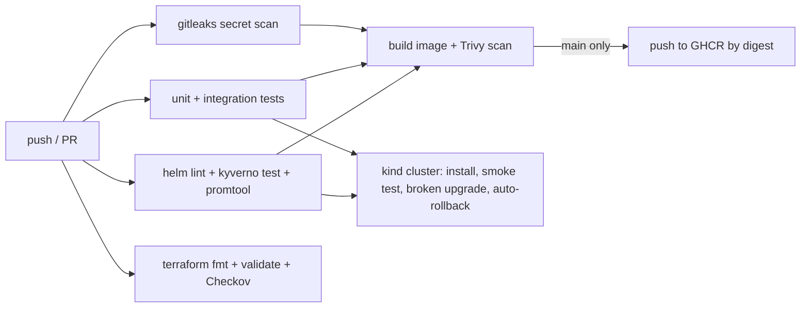

# secure-k8s-platform

[](https://github.com/mest0006/secure-k8s-platform/actions/workflows/ci.yml)

A small, working reference for how I build and ship services on Kubernetes with security in the pipeline: a hardened container, a locked-down Helm chart, Kyverno guardrails, Terraform for a production-style AKS cluster, SLO alerting, and a GitHub Actions pipeline that tests, scans, deploys to a throwaway cluster and proves rollback works.

It mirrors patterns I use day to day on a 20-service platform: deploy by digest instead of `:latest`, gate every build on scanning, enforce pod security at admission, and alert on error-budget burn instead of raw thresholds.

## What's in here

| Path | What it shows |
|---|---|
| `app/` | `hello-api`, a standard-library Python service with health, readiness and Prometheus metrics endpoints, plus unit and integration tests. Graceful shutdown fails readiness before stopping. |
| `app/Dockerfile` | Distroless, non-root image with no shell or package manager. |
| `charts/hello-api/` | Helm chart: non-root, read-only root filesystem, all capabilities dropped, seccomp, probes, resource limits, PodDisruptionBudget, default-deny NetworkPolicy, optional ServiceMonitor. Deploys by digest when one is given. |
| `policies/kyverno/` | Admission policies (no `:latest`, pod security, requests and limits, allowed registries) with `kyverno test` cases that prove bad pods are blocked. |
| `terraform/` | AKS module: Entra ID + Azure RBAC with local accounts disabled, workload identity, Azure Policy, Azure CNI overlay with Calico network policy, zone-spread autoscaling node pool, Key Vault with RBAC and the CSI secrets provider, Log Analytics. |
| `observability/` | SLO recording rules, multi-window burn-rate alerts, and a Grafana dashboard. |
| `.github/workflows/ci.yml` | The pipeline described below. |
| `docs/` | Runbook and security notes. |

## Pipeline



- **Shift-left security:** secrets, IaC misconfigurations, image CVEs (fail on fixable HIGH/CRITICAL) and policy violations are caught before anything merges.
- **Policy as code is tested:** the rendered Helm chart must pass every Kyverno policy, and the policies have their own test suite.
- **Deploy by digest:** the push job records the image digest; environments deploy that digest, so production runs exactly what was scanned.
- **Rollback is tested, not assumed:** the e2e job upgrades to an image that doesn't exist, `helm --atomic` rolls back, and the smoke test runs again.

## Run it locally

```bash
# tests (no dependencies needed)
python -m unittest discover -s app/tests -v

# policies
kyverno test policies/kyverno/tests

# full deploy on a local cluster
kind create cluster --name dev
docker build -t ghcr.io/mest0006/hello-api:dev app
kind load docker-image ghcr.io/mest0006/hello-api:dev --name dev
helm install hello-api charts/hello-api --set image.tag=dev --set networkPolicy.enabled=false --wait
scripts/smoke-test.sh
```

## Design decisions

- **Standard library only.** The service has no third-party packages, so there's nothing to patch beyond the base image. Real services won't be this lean, but the pipeline handles them the same way.
- **Distroless + read-only filesystem.** Removes the shell and most of the attack surface; `/tmp` is a small `emptyDir` for anything that must write.
- **Default-deny NetworkPolicy.** Only the ingress controller and monitoring namespaces can reach the pod, and the pod can only reach cluster DNS.
- **Burn-rate alerts over thresholds.** A 14.4x burn over one hour pages; a 6x burn over six hours opens a ticket. This cuts noise while still catching real budget loss.
- **AKS without local accounts.** Cluster access goes through Entra ID groups and Azure RBAC, so access is audited and revocable in one place. Pods get Azure access through workload identity instead of stored credentials.
- **Checkov is report-only.** Findings show in the job log and are triaged in `docs/security.md` rather than blocking every change on a reference project.

## License

MIT
